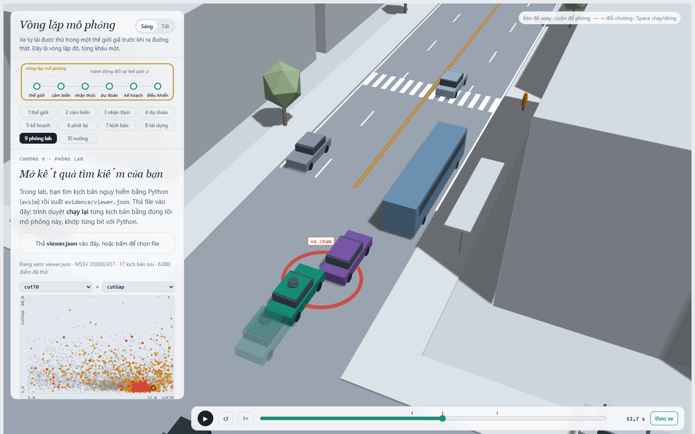
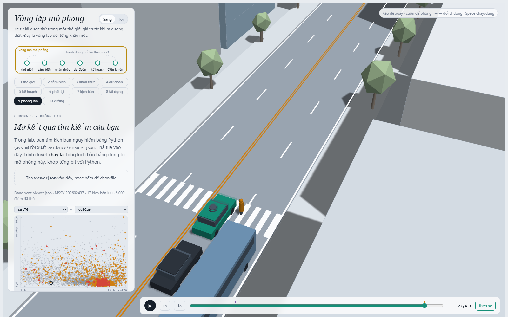
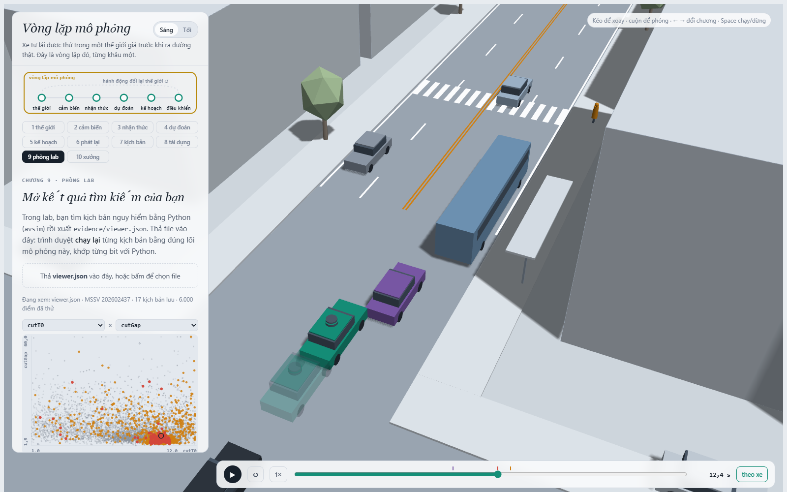
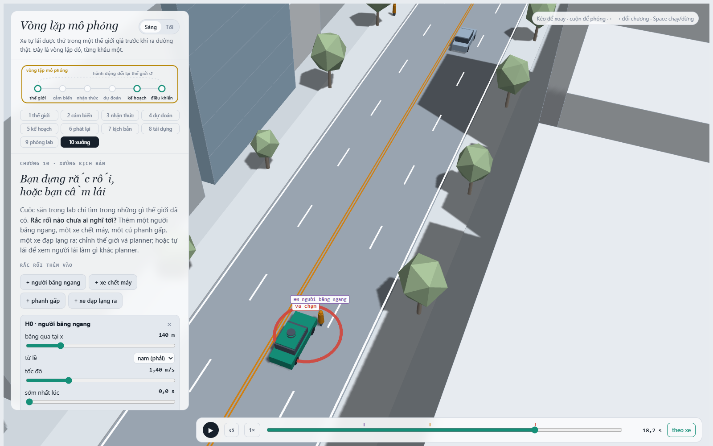
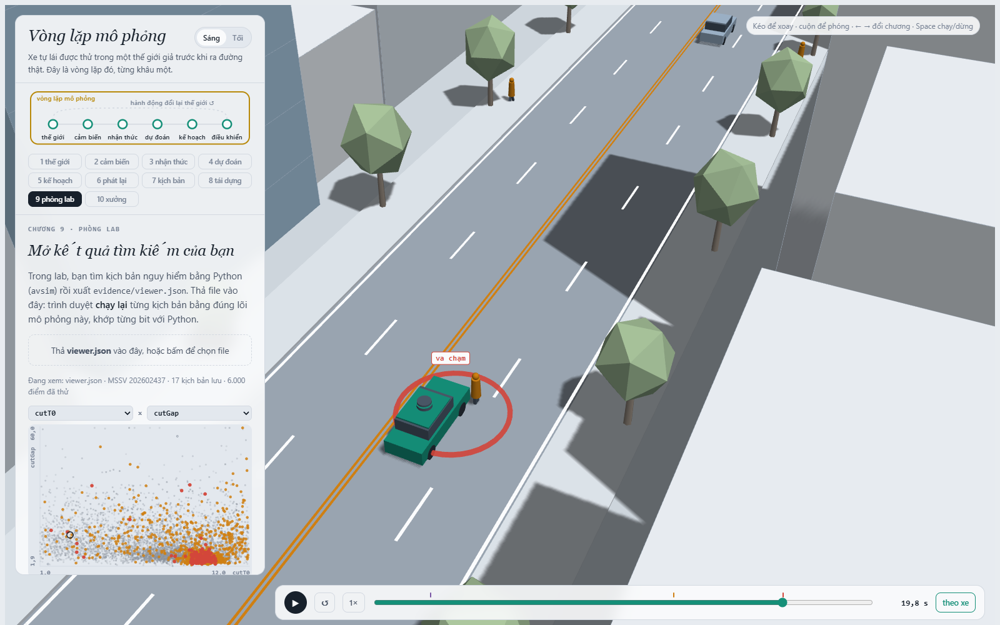

MSSV: 202602437

# Lab 11 · Scenario Forge — báo cáo

Mỗi câu: trả lời ngắn, **trích số từ `evidence/`** (ghi tên file và trường, ví dụ `mc.json: crashes = 4`). Grader chạy lại với MSSV của bạn; số không khớp `evidence/` thì mất điểm phần D (RUBRIC), và câu dựa trên số sai khó được điểm đầy đủ. Không cần văn hay: một bảng nhỏ và hai, ba câu giải thích là đủ.

Thị trấn của bạn (`meta.json: _run.town`): A

## 1. Phát lại log có trung thực không? (bước A)

Trong `replay.json`: bao nhiêu kịch bản bị bỏ vì người lái gây va chạm, bao nhiêu va chạm khi planner chạy trên log phát lại, bao nhiêu trong thế giới phản ứng, theo từng loại tiếp xúc. Giải thích vì sao phần lớn va chạm của "phát lại" là `rear`, và vì sao đó là va chạm **giả**. Chọn một kịch bản trong `replay_only` và nói chuyện gì đã xảy ra.

| `replay.json` | giá trị |
|---|---|
| `n` / `n_used` | 400 / 400 |
| `dropped_human_crash_logs` (log người lái tự va chạm, bị bỏ) | 0 |
| `replay.crashes` (planner trên log phát lại) | **98**: `rear` 85, `side` 13, `front` 0 |
| `reactive.crashes` (planner trong thế giới phản ứng) | **0** |
| `crash_in_both` | 0 |

85/98 va chạm của "phát lại" là `rear`: xe phía sau (chủ yếu xe bám đuôi TG) chạy **đúng quỹ đạo đã ghi** trong log, tức quỹ đạo phản ứng với **người lái**, không phải với planner. Planner thận trọng hơn người lái (giảm xuống `cautionV` gần vạch bị che, dừng nhường người đi bộ), nên phanh sớm hơn hoặc dừng ở chỗ người lái không dừng. Log không biết điều đó, xe sau không phanh và tông vào đuôi. Đây là va chạm **giả**: ngoài đời xe sau thấy xe ta phanh và phanh theo. Bằng chứng: `crash_in_both = 0` và cùng 400 kịch bản trong thế giới phản ứng cho 0 va chạm.

Ví dụ `replay_only[0]`: kịch bản 5, `contact = "rear"`, `min_ttc_reactive = 7.46` s (`tgT` = 0,67 s, xe bám đuôi rất sát). Chạy lại bằng `avsim`: người lái đi 9,5–10,6 m/s và qua vạch trước khi người đi bộ bước xuống. Planner đi chậm (7,3 m/s, tốc độ thận trọng), tới gần vạch thì thấy người đi bộ, phanh −7,8 m/s² và dừng ở x = 115,4 m. TG trong log vẫn chạy như khi người lái đã đi trước khoảng 26 m, nên tông vào đuôi xe ta lúc 16,65 s (sự kiện có `fake: true`). Trong thế giới phản ứng, TG thấy xe ta phanh và phanh theo: không có va chạm nào, TTC nhỏ nhất của xe ta là 7,46 s.

## 2. Kịch bản bất khả thi (bước B)

Liệt kê các luật trong `is_feasible` và căn cứ vật lý của từng luật (ma sát, gia tốc, tốc độ người). Trong `hunt.json`, cuộc săn nào sinh nhiều kịch bản bất khả thi nhất, và vì sao CEM lại bị kéo về phía đó? Điều gì xảy ra với ước lượng nếu bạn **đếm** chúng là va chạm?

| Luật (loại nếu) | Căn cứ vật lý |
|---|---|
| a_lat = (π / `cutDur`)² · 3,5 / 2 > μg | Chuyển làn hình cos 3,5 m trong `cutDur` giây có gia tốc ngang đỉnh như vậy. Lốp chỉ cho tối đa μg lực ngang (vòng ma sát): vượt μg là xe trượt, không ai chuyển làn được như thế. Đường ướt μ = 0,5 cho μg = 4,9 m/s², tức `cutDur` phải ≥ 1,88 s. |
| `cutBrake` > μg | Phanh không thể giảm tốc nhanh hơn ma sát lốp–đường cho phép (≈ 7,8 m/s² khô, 4,9 m/s² ướt). |
| `pedV` > 2,5 m/s | Người đi bộ thường đi 1,2–1,5 m/s; trên 2,5 m/s là chạy, không còn là kịch bản "người đi bộ qua đường" mà phân phối mô tả. |
| `cutV` ∉ (0, 22] m/s | Xe chuyển làn phải đang chạy (> 0), và 22 m/s ≈ 79 km/h là giới hạn hợp lý trên phố đô thị này. |

`hunt.json: infeasible`: `crosswalk_block` = **38** (nhiều nhất), `cut_in` = 3, `bus_bypass` = 2, `rear_ended` = 1. Đếm lại trong `cloud.json` thì cả 38 vụ của cuộc săn `crosswalk_block` đều vi phạm cùng một luật, **gia tốc ngang > μg**. Lý do: điểm nguy hiểm của kiểu này (`ped_room`, khoảng phanh còn lại) lớn nhất khi đường ướt, nên CEM kéo xác suất đường ướt lên `hunt.json: crosswalk_block.proposal.p_bin[0]` = 0,88 (tự nhiên 0,20). Trên đường ướt, một lần chuyển làn nhanh vốn khả thi khi khô trở thành bất khả thi. Nói chung kịch bản bất khả thi thường là kịch bản "nguy hiểm" nhất (trượt, phanh vượt ma sát, người chạy), nên CEM, vốn chỉ tối ưu điểm nguy hiểm, bị hút về phía đó.

Nếu **đếm** chúng là va chạm: ước lượng bị **thổi phồng** bởi những thất bại không thể xảy ra. Tệ hơn, chúng có điểm nguy hiểm cao nhất nên lọt vào elite, CEM tiếp tục dồn đề xuất vào vùng bất khả thi, và trọng số IS lại tính chúng là va chạm có xác suất tự nhiên dương. Con số báo ra khi đó đo khả năng vi phạm vật lý chứ không đo planner.

## 3. Monte Carlo cho bạn biết gì (bước C1)

`mc.json`: k, n, p̂ và khoảng Wilson 95 %. Với p̂ đó, cần bao nhiêu lần chạy để khoảng tin cậy hẹp lại còn ±20 % của p? Có kiểu thất bại nào **chưa hề xuất hiện** trong 3 000 lần chạy không? Con số đúng cần báo cho kiểu đó là gì?

`mc.json`: `crashes` k = **4**, `n` = **3000**, `p` = **1,33·10⁻³**, Wilson 95 % [`lo` = 5,19·10⁻⁴, `hi` = 3,42·10⁻³]; `modes` = {`bus_bypass`: 4}; `infeasible` = 14 (không chạy, không đếm).

Khoảng ±20 % của p: 1,96·√((1−p)/(n·p)) = 0,2, tức n ≈ (1,96/0,2)²·(1−p)/p ≈ **96/p ≈ 72 000 lần chạy**, gấp 24 lần 3 000.

Chưa xuất hiện: `cut_in`, `crosswalk_block`, `rear_ended`, `other` đều có k = 0 (`mc.json: per_mode`). Con số đúng **không phải 0** mà là cận trên Wilson: `per_mode.<kiểu>.hi` = **1,28·10⁻³** (≈ 3,84/n), tức "với 95 % tin cậy, P < 1,28·10⁻³". Riêng `crosswalk_block` chưa hề thấy trong Monte Carlo nhưng cuộc săn CEM tìm thấy (câu 5): k = 0 không có nghĩa là "không bao giờ".

## 4. Importance sampling, ESS và độ suy biến (bước C3)

Bảng: với từng kiểu và từng seed trong `estimate.json`, ghi `p`, `hits`, `ess`, `top_share`. Ba seed có đồng ý với nhau không, và có đồng ý với Monte Carlo không? Ở đâu `top_share` lớn (> 0,5), và vì sao khi đó con số thực ra chỉ là trọng số của một mẫu? So ngân sách (`budget`) với số lần chạy Monte Carlo cần để có cùng độ chính xác. Phần `other` trong tổng lấy từ đâu, và vì sao không săn nó?

`estimate.json: seeds[i].per.<kiểu>` (mỗi kiểu `n` = 600):

| seed | kiểu | `p` | `hits` | `ess` | `top_share` |
|---|---|---|---|---|---|
| 0 | bus_bypass | 7,54·10⁻⁴ | 37 | 137,2 | 0,139 |
| 0 | cut_in | 0 (`upper_zero_hits` = 0,025) | 0 | 116,0 | 0 |
| 0 | crosswalk_block | 1,40·10⁻⁶ | 63 | 130,2 | 0,363 |
| 0 | rear_ended | 0 (`upper_zero_hits` = 0,025) | 0 | 131,2 | 0 |
| 1 | bus_bypass | 1,81·10⁻³ | 30 | 130,3 | 0,406 |
| 1 | cut_in | 0 (`upper_zero_hits` = 0,025) | 0 | 110,0 | 0 |
| 1 | crosswalk_block | 3,44·10⁻⁷ | 43 | 125,1 | **0,551** |
| 1 | rear_ended | 0 (`upper_zero_hits` = 0,025) | 0 | 116,5 | 0 |
| 2 | bus_bypass | 1,23·10⁻³ | 38 | 134,2 | 0,331 |
| 2 | cut_in | 0 (`upper_zero_hits` = 0,025) | 0 | 119,1 | 0 |
| 2 | crosswalk_block | 6,44·10⁻⁶ | 56 | 123,3 | **0,969** |
| 2 | rear_ended | 0 (`upper_zero_hits` = 0,025) | 0 | 111,7 | 0 |

`total`: seed 0 = 7,55·10⁻⁴, seed 1 = 1,81·10⁻³, seed 2 = 1,24·10⁻³ (trung vị 1,24·10⁻³).

- **Đồng ý?** `bus_bypass`: ba seed chênh 2,4 lần (7,5·10⁻⁴ – 1,8·10⁻³), cả ba nằm trong khoảng Wilson của Monte Carlo [5,2·10⁻⁴; 3,4·10⁻³], và trung vị `total` 1,24·10⁻³ gần `mc.json: p` = 1,33·10⁻³. `crosswalk_block`: ba seed chênh **19 lần** (3,4·10⁻⁷ – 6,4·10⁻⁶). Monte Carlo chỉ nói được < 1,28·10⁻³, nên không mâu thuẫn nhưng cũng không kiểm chứng được. Chênh hàng chục lần là dấu hiệu bẫy 3: cuộc săn tìm ra **một** cách chặn lối (đường ướt + người không ngó qua xe buýt, `p_bin` = [0,88; 0,03; …]), chưa chắc là cách hay xảy ra nhất. Vì vậy con số này nhiều khả năng **thấp** hơn sự thật.
- **`top_share` > 0,5:** `crosswalk_block` seed 1 (0,551) và seed 2 (0,969). Ở seed 2, một mẫu mang 97 % ước lượng: p = mean(w·y) ≈ w_max/600, nên con số thực chất là trọng số p/q của **một** kịch bản. Rút lại mà mẫu đó không xuất hiện thì p tụt hẳn (như seed 1, nhỏ hơn 19 lần). Khoảng ±1,96·se khi đó hẹp sai. Ngược lại, `top_share` thấp (`bus_bypass` seed 0: 0,139) cũng không chứng minh ước lượng đúng, vì q có thể bỏ sót cả một vùng va chạm.
- **Ngân sách:** `estimate.json: budget` = **16 800** lần chạy (4 cuộc săn × 8 vòng × 300, cộng 3 seed × 4 kiểu × 600). Monte Carlo cần n = p(1−p)/se² để có cùng se (tính từ `p` và `se` trong bảng): `bus_bypass` seed 0 (se 1,96·10⁻⁴) cần ≈ 19 600 lần cho riêng kiểu này, trong khi IS dùng 2 400 + 600; `crosswalk_block` seed 0 (p 1,4·10⁻⁶, se 6,7·10⁻⁷) cần ≈ **3,1 triệu** lần, so với 3 000 của IS. Với cả tổng ở ±20 %, Monte Carlo cần ≈ 72 000 lần (câu 3).
- **`other`:** lấy từ Monte Carlo C1: `estimate.json: other` = {k = 0, n = 3000, p = 0, `hi` = 1,28·10⁻³, `source` = "mc.json"}. Không săn vì `other` không có một cơ chế chung nào để viết điểm nguy hiểm. Nó là phần dư của mọi va chạm không thuộc 4 kiểu, nên CEM không có hướng để kéo q về. Tổng = các kiểu + `other`.

## 5. Các kiểu thất bại (bước C2 + 3D)

Mỗi kiểu bạn tìm thấy: một ảnh chụp trình xem 3D (chương 9) ở đúng lúc va chạm, và một câu mô tả chuỗi sự kiện (ai thấy gì, ai chờ gì). Kiểu nào cuộc săn **không** tìm thấy, và bạn tin điều đó ở mức nào? Nếu chỉ chạy **một** cuộc săn chung cho mọi kiểu thì điều gì xảy ra (gợi ý: `hunt.json: found` của từng cuộc săn)?

**`bus_bypass`**: `viewer.json` B-01, t = 12,65 s.

Xe buýt đỗ ở làn ngoài E2 (x ≈ 106). C2 đi sau xe buýt, chờ không được nên chậm gần như dừng (0,1 m/s) và lách dần sang làn xe ta (z từ 5,25 xuống 3,18). Xe ta tới với 7,1 m/s (tốc độ thận trọng). Đến 12,15 s, C2 còn lệch ngang ≈ 2,2 m, lớn hơn `cutinLat` = 2,15, nên planner **chưa coi C2 là xe phía trước** (xe phía trước vẫn là L1) và không phanh. Đến 12,35 s, khi C2 lấn vào trong ngưỡng, planner mới nhận C2 và phanh −7,8 m/s², nhưng vẫn đâm vào C2 lúc 12,65 s ở 3,6 m/s (tiếp xúc `front`).

**`crosswalk_block`**: `viewer.json` C-01, t = 22,4 s.

Đường ướt (μ = 0,5), người đi bộ **không ngó qua xe buýt** (`pedLook` = 0). Xe buýt đỗ ở x ≈ 112,6, che tầm nhìn giữa xe ta và người đi bộ ở vạch (x = 122). Người đi bộ không thấy xe ta nên bước xuống lúc 15,15 s. Cảm biến xe ta chỉ thấy họ từ 17,35 s, khi xe đang chạy 7,1 m/s và còn cách vạch ≈ 7 m. Trên đường ướt xe chỉ phanh được μg ≈ 4,9 m/s², nên dừng ở x = 120,3 với mũi xe nằm trên vạch. Người đi bộ đi tới sát thân xe thì phải đứng lại: sự kiện `kind = "block"` lúc 22,4 s.

**Không tìm thấy:** `cut_in` và `rear_ended`. `hunt.json: cut_in.found` = {`bus_bypass`: 23}, `hunt.json: rear_ended.found` = {`bus_bypass`: 5, `crosswalk_block`: 2}: hai cuộc săn này trôi sang kiểu khác. Mức tin: **thấp**. Cái ta có chỉ là cận trên `estimate.json: upper_zero_hits` = 0,025 (3/(0,2·600)) và `mc.json: per_mode.*.hi` = 1,28·10⁻³, không phải bằng chứng là kiểu đó không tồn tại. Điểm nguy hiểm của `cut_in` dừng ở mức −3,18 (TTC nhỏ nhất ≈ 3,2 s): planner xử lý cắt làn khá tốt trong vùng đã tìm, nhưng 8 vòng × 300 mẫu không loại được một vùng hẹp hơn.

**Một cuộc săn chung:** CEM co về kiểu dễ nhất. Chính `cut_in` cho thấy điều đó: săn `cut_in` mà chỉ tìm được 23 vụ `bus_bypass`. Cuộc săn `bus_bypass` tìm 155 vụ, cuộc săn `crosswalk_block` chỉ 23 (và cần đường ướt). Một cuộc săn chung sẽ dồn hết vào `bus_bypass`, gần như không bao giờ tới `crosswalk_block`, và báo sót cả một kiểu. Vì vậy mỗi kiểu có một cuộc săn riêng với điểm nguy hiểm riêng.

## 6. Sửa planner (bước E + 3D)

`fix.json`: policy được chọn, `fail` và `fail_hi` trên TRAIN, trên TEST (`fail_hi_seen` và `fail_hi`), và của policy gốc trên TEST; vì sao `fail_hi` của bản sửa có thể lớn hơn `fail` của policy gốc dù bản sửa tốt hơn thật? quãng đường và số lần phanh gấp. Một ảnh chụp 3D có **bóng mờ** (policy gốc) cho một kịch bản mà bản sửa tránh được. Có núm chỉnh nào "nghe thì an toàn hơn" nhưng thực tế làm tăng thất bại? Giải thích bằng cách thế giới phản ứng lại.

Policy được chọn: `fix.json: chosen.policy` = **{`cutinLat`: 3.0}** (coi xe lấn làn là xe phía trước từ khi nó còn cách ngang 3,0 m, thay vì 2,15 m).

| `fix.json` | `fail` | `fail_hi_seen` | `fail_hi` | `unseen` | `progress` (m) | `harsh` (khung) |
|---|---|---|---|---|---|---|
| `baseline_train` (gốc, TRAIN) | 9,38·10⁻⁴ | 1,47·10⁻³ | 1,47·10⁻³ | – | 215,2 | 8,13 |
| `chosen` (bản sửa, TRAIN) | 1,21·10⁻⁶ | 2,97·10⁻⁶ | 2,97·10⁻⁶ | bus_bypass | 214,9 | 7,52 |
| `chosen_test` (bản sửa, **TEST**) | **1,88·10⁻⁶** | **3,40·10⁻⁶** | **3,88·10⁻²** | bus_bypass | 214,5 | 7,95 |
| `baseline_test` (gốc, **TEST**) | **8,34·10⁻⁴** | 1,91·10⁻³ | **3,19·10⁻³** | – | 214,6 | 8,35 |

TRAIN chỉ dùng để sàng; con số báo là TEST. Trên TEST, bản sửa không còn vụ `bus_bypass` nào (`chosen_test.bus_bypass.hits` = 0, kể cả với một cuộc săn mới nhắm vào chính nó), `crosswalk_block` gần như không đổi (1,88·10⁻⁶ so với 1,28·10⁻⁶), quãng đường giữ nguyên (214,5 so với 214,6 m) và phanh gấp ít hơn (7,95 so với 8,35 khung).

**Vì sao `fail_hi` bản sửa (3,88·10⁻²) > `fail` gốc (8,34·10⁻⁴):** `bus_bypass` là `unseen` (0 hits), nên TEST cộng cận hợp lệ của nó: `upper_zero_hits` = 3/(0,2·400) = **0,0375**, cộng `other_crashes.hi` = 1,28·10⁻³ (0 va chạm trên 3 000 lần tự nhiên). Một kiểu đã biến mất vẫn bị chặn trên ở ≈ 15/n. Với n = 400 không chứng nhận được gì dưới 10⁻²; muốn chứng nhận p < 10⁻³ cần cỡ 15 000 lần chạy trên đúng chỗ đó. Bản sửa tốt hơn thật (`fail_hi_seen` 3,4·10⁻⁶ so với 1,91·10⁻³), nhưng dữ liệu ở ngân sách này không **chứng minh** được điều đó.

**Ảnh có bóng mờ:** `viewer.json` B-02, t = 12,4 s. Xe đậm là policy gốc (kịch bản săn được dưới policy gốc), đâm vào C2 đang lách qua xe buýt. **Bóng mờ** là bản sửa `cutinLat` 3,0 trên cùng kịch bản: nó nhận C2 làm xe phía trước sớm hơn, phanh sớm và dừng phía sau, không va chạm. Chạy lại bằng `avsim`: cả 4 vụ B-01…B-04 đều biến mất với bản sửa, cả 4 vụ C-01…C-04 thì vẫn còn.

**Núm "nghe thì an toàn hơn" nhưng tăng thất bại** (`fix.json: table`, cùng mẫu TRAIN):
- **`T` = 2,0** (giữ khoảng cách thời gian xa hơn): `fail` = 9,95·10⁻⁴ > gốc 9,38·10⁻⁴. Số `bus_bypass` tăng từ 25 lên 30 hits, `crosswalk_block` từ 55 lên 88 hits. Cách giải thích theo luật hành vi của thế giới: khe trống trước xe ta rộng hơn, nên C2 (chờ khe đủ rộng, *gap acceptance*) **chấp nhận khe và lách vào** thường hơn, ngay trước mũi xe ta. Xe ta chạy chậm hơn nên tới vạch muộn hơn, đúng lúc người đi bộ đã thấy khe và bước xuống, rồi phải dừng gấp trên vạch.
- **`cautionV` thấp hơn** (6,5 hoặc 6,0 thay vì 7,5): `crosswalk_block` tăng từ 55 lên 71 hits với 6,5 (`fail` 6,4·10⁻⁴ chỉ giảm nhờ `bus_bypass`), và `cautionV` 6,0 có `fail` = 9,34·10⁻⁴ ≈ gốc. Người đi bộ chờ đến khi xe gần nhất **họ thấy** còn đủ xa theo thời gian. Xe ta đi chậm thì "còn xa" lâu hơn, người đi bộ bước xuống khi xe đã khá gần, và xe ta chậm vẫn phải dừng với mũi xe trên vạch. Đi chậm còn làm mất quãng đường (190,5 m với `cautionV` 6,0), và `cautionV` 5,0 bị `choose_policy` loại vì chỉ còn 171,2 m (mất > 5 %).

## 7. Từ mô phỏng ra đường thật

Phân phối tự nhiên trong `space.py` là giả định. Chọn **ba** giả định ảnh hưởng nhiều nhất đến con số của bạn (ví dụ khe chấp nhận của xe chuyển làn, tỉ lệ người đi bộ ngó qua xe buýt, ma sát đường ướt). Với mỗi cái: dữ liệu thật nào sẽ thay nó, lấy từ đâu, và nếu nó sai thì con số của bạn sai theo hướng nào?

| Giả định (`space.py`, thị trấn A) | Ảnh hưởng | Dữ liệu thật thay nó, lấy từ đâu | Nếu sai thì |
|---|---|---|---|
| **Khe chấp nhận của xe lách qua xe buýt** `cutGap` ~ log-normal, trung vị 12 m (`cut_gap_median` thị trấn A) | Quyết định `bus_bypass`, gần toàn bộ `mc.json: p` (4/4 vụ) | Quỹ đạo chuyển làn và nhập làn đo từ trên cao: bộ dữ liệu drone highD / inD (levelXData), NGSIM (FHWA). Tốt nhất là camera đặt tại một trạm buýt đô thị thật, đo khe mà xe sau xe buýt chấp nhận khi lách. | Ngoài đời (giao thông hỗn hợp, xe máy) người lái **liều hơn**, khe nhỏ hơn, nên `bus_bypass` của tôi đang bị **đánh giá thấp**. Ngược lại nếu người lái thật kiên nhẫn hơn. |
| **Tỉ lệ người đi bộ ngó qua xe buýt** `pedLook` = 0,85 | Mọi vụ `crosswalk_block` tìm được đều có `pedLook` = 0 (`hunt.json: crosswalk_block.proposal.p_bin[1]` = 0,03) | Quan sát video tại vạch qua đường cạnh trạm buýt (đếm người ngó trước khi bước); bộ dữ liệu hành vi người đi bộ có nhãn chú ý/quay đầu như JAAD, PIE (Đại học York). | Nếu ngoài đời ít người ngó hơn (vội, dùng điện thoại) thì `crosswalk_block` (≈ 10⁻⁶) bị **đánh giá thấp**, có thể nhiều bậc độ lớn vì xác suất tự nhiên của mỗi mẫu tỉ lệ với (1 − 0,85). |
| **Đường ướt**: 20 % chuyến, μ = 0,5 (khô 0,8) | `crosswalk_block` cần đường ướt (`p_bin[0]` = 0,88 trong cuộc săn); μ còn chặn luật bất khả thi ở câu 2 | Số giờ mưa theo mùa từ trạm khí tượng địa phương (ví dụ Trung tâm Khí tượng Thuỷ văn quốc gia cho Hà Nội); hệ số ma sát đo thật bằng xe đo ma sát (skid trailer ASTM E274, GripTester) trên mặt đường đô thị khô và ướt. | Nếu mưa nhiều hơn 20 % (mùa mưa) hoặc μ ướt < 0,5 (mặt đường mòn, dầu) thì `crosswalk_block` và cả `bus_bypass` bị **đánh giá thấp**. Một mặt đường chỉ có hai mức μ cũng giấu các trường hợp xấu nhất (vũng nước, vạch sơn ướt). |

## 8. Giới hạn

Ba điều mà xác suất bạn báo **không** nói, ví dụ: thế giới chỉ có một con phố; người lái chỉ là IDM; cảm biến hoàn hảo trừ phần bị xe buýt che. Nếu được thêm một tuần, bạn sẽ đo gì tiếp?

1. **Một con phố, 24 s, một trạm buýt.** P ≈ 1,2·10⁻³ (`estimate.json: total`, trung vị) là xác suất **mỗi lần đi qua đúng đoạn phố này** trong 24 s. Nó không phải tỉ lệ mỗi km hay mỗi giờ lái, và không nói gì về giao lộ, đường cao tốc, ban đêm hay xe máy.
2. **Mọi tác nhân khác là IDM, chỉ có 3 nhóm hành vi.** Người lái và người đi bộ ở đây "cư xử tốt" theo luật cứng (chấp nhận khe, nhường, người đi bộ không bao giờ bước vào thân xe). Không có người vượt đèn, xe máy len lỏi, người đi bộ đổi ý giữa đường, nên các kiểu `other` = 0 (`mc.json: per_mode.other.k` = 0) chỉ có nghĩa là thế giới này không tạo ra chúng.
3. **Cảm biến hoàn hảo trừ phần bị xe buýt che, và planner chỉ phanh.** Không có nhiễu, trễ hay nhận sai trong nhận thức (mọi thứ nằm trong tầm nhìn là thấy ngay, đúng vị trí, đúng tốc độ), và không đánh lái tránh. Con số của tôi là của planner trên **ground truth**, nên nhiều khả năng lạc quan so với một hệ thống thật.
4. Ngoài ra con số IS **phụ thuộc vào seed và lệch thấp** (`crosswalk_block` chênh 19 lần giữa 3 seed), và mọi phân phối là giả định dạy học (câu 7).

**Thêm một tuần:**
1. Chạy `crosswalk_block` với nhiều seed hơn và nhiều cuộc săn khởi đầu khác nhau (ví dụ ép `pedLook` = 1 hoặc đường khô) để xem có vùng va chạm thứ hai mà q đang bỏ sót không. Kiểm tra bằng một Monte Carlo có điều kiện (đường ướt, `pedLook` = 0) cỡ 10⁵ lần.
2. Thêm nhiễu và trễ cảm biến (ví dụ 0,2–0,5 s) để đo xem P nhạy với nhận thức đến đâu.
3. Đo khe chấp nhận và tỉ lệ ngó qua xe buýt bằng video tại một trạm buýt thật, rồi chạy lại để thay giả định ở câu 7.

## 9. Rắc rối của bạn (bước G + chương 10)

- **Rắc rối:** bạn dựng gì, và ngoài đời nó giống tình huống nào.

  Một **người băng ngang ngoài vạch, ngay sau vạch qua đường, từ lề phía trạm xe buýt** (`hazard.json: hazards[0]` = `ped`, `side` = "S" (lề phải), x = 140 m, v = 1,4 m/s, bước xuống khi xe ta còn cách 40 m). Ngoài đời: khách vừa xuống xe buýt không quay lại vạch mà băng thẳng qua đường cách vạch vài chục mét. Cảnh dựng (`mine.json: exact.planner`) = [("ego", "H0", 18,2 s)]: người đi bộ bước xuống lúc 13,75 s, cảm biến thấy ngay, vậy mà planner vẫn đâm họ lúc 18,2 s ở ≈ 6,6 m/s.

- **Căn cứ:** vì sao bạn nghĩ planner sẽ xử lý kém.

  Trong `avsim/core.py`, planner chỉ **dự đoán** người đi bộ P1 ở vạch qua đường (`yieldp`: so thời điểm người vào làn với thời điểm xe tới, cộng `pedBuffer`). Mọi người đi bộ khác chỉ được coi là chướng ngại khi họ **đã ở trong** hành lang ±1,9 m của xe ta. Người băng ngang ngoài vạch vì thế bị bỏ qua cho đến khi bước vào làn, lúc đó phanh thường đã muộn. Vì không có núm nào điều khiển phần này, tôi đoán bản sửa ở bước E cũng không cứu được. Tôi đã thử nhanh ba rắc rối khác (300 phiên bản mỗi loại): xe dẫn L1 phanh gấp và xe chết máy trong làn đều cho 0 va chạm (planner IDM xử lý tốt); người băng ngang từ lề bắc cho ít va chạm hơn (phải đi qua hai làn ngược chiều trước).

- **Giả định:** `space` và `exposure` lấy từ đâu (`hazard.json: why`).

  `space` = {`h0_x`: [128, 160], `h0_v`: [1,0; 1,8], `h0_trig`: [20, 60]}, `exposure` = 0,02:
  - `h0_x` [128, 160]: điểm băng cách tâm vạch (x = 122) 6–38 m, là đoạn người đi bộ thường đi tiếp thay vì vòng lại vạch.
  - `h0_v` [1,0; 1,8] m/s: 1,07 m/s là tốc độ thiết kế cho người đi chậm (MUTCD 2009, 3,5 ft/s); 1,2–1,5 m/s là trung bình người lớn (Knoblauch et al. 1996, FHWA-RD-95-202); 1,8 m/s là đi vội nhưng chưa chạy (luật khả thi < 2,5 m/s).
  - `h0_trig` [20, 60] m: người bước ra khi xe ta còn cách 20–60 m, tức khe thời gian ≈ 2–5 s ở 10–12,5 m/s, ngắn hơn khe an toàn 4–6 s, đúng kiểu băng ẩu.
  - `exposure` = 0,02 mỗi chuyến là **ước lượng Fermi, không phải số đo**: xác suất xe ta đi qua đoạn này trong ≈ 1 phút sau khi xe buýt trả khách (buýt 10 phút một chuyến, ≈ 0,1) × có khách xuống (≈ 0,8) × tỉ lệ khách băng ngoài vạch (≈ 0,25) ≈ 0,02. Cần thay bằng đếm thực địa tại trạm.

- **Kết quả**, theo `mine.json`:
  - số va chạm `avoidable` (tránh được bằng phanh hết cỡ, biết trước), `unavoidable`, `unattributed`, và `low_speed`, với policy gốc và với policy bạn chọn; `accepted` (bao nhiêu phần `space` của bạn là khả thi);
  - P(lỗi planner | rắc rối) kèm khoảng Wilson;
  - tần suất mỗi chuyến, đặt cạnh tần suất lách xe buýt của bạn.

  `mine.json: accepted` = **0,996** (1 494 / 1 500 khả thi, `infeasible` = 6), quét trong giao thông thị trấn A (`conditional_on` = "your town's traffic").

  | `mine.json` | `crashes` | `avoidable` | `unavoidable` | `unattributed` | `low_speed` | `avoidable_foreknown` | P(lỗi planner \| rắc rối) [Wilson 95 %] | `per_trip` (`per_trip_hi`) |
  |---|---|---|---|---|---|---|---|---|
  | `baseline` (gốc) | 71 | **68** | 0 | 3 | 1 | 68 | **4,55·10⁻²** [3,61·10⁻²; 5,73·10⁻²] | **9,10·10⁻⁴** (1,15·10⁻³) |
  | `chosen` (`cutinLat` 3,0) | 69 | **69** | 0 | 0 | 1 | 69 | **4,62·10⁻²** [3,67·10⁻²; 5,80·10⁻²] | **9,24·10⁻⁴** (1,16·10⁻³) |

  - Gần như mọi va chạm đều `avoidable`: phanh hết cỡ ngay từ lúc người đi bộ bước ra **và** cảm biến thấy họ thì không va chạm. `unavoidable` = 0, tức rắc rối này không phải "100 % ai cũng dính", mà là **lỗi của planner**.
  - `avoidable_foreknown` = `avoidable`: người đi bộ ở x ≥ 128 m, sau xe buýt, nên không bị che. Lỗi không đến từ tầm nhìn mà từ việc planner **không dự đoán** họ.
  - 3 vụ `unattributed` của policy gốc là va chạm thường của thị trấn (ví dụ `examples`: xe ta đâm C2 lúc 12,55 s, khi người đi bộ chưa bước ra): đó là `bus_bypass`, không nói gì về rắc rối của tôi. Bản sửa đưa số này về 0, khớp với câu 6.
  - **Bản sửa không cứu:** `avoidable` 68 → 69, P không đổi trong sai số.
  - Tần suất mỗi chuyến: 9,1·10⁻⁴ (cận trên 1,15·10⁻³), **cùng bậc** với lách xe buýt: `mc.json: per_mode.bus_bypass` k = 4/3000 = 1,33·10⁻³, `estimate.json` `bus_bypass` 7,5·10⁻⁴ – 1,8·10⁻³ mỗi lần chạy (một lần chạy là một lần đi qua đoạn phố này). Nếu `exposure` đúng thì đây là kiểu thất bại nặng ký thứ hai, và là kiểu **còn lại** sau bản sửa.
  - "Tránh được" là **chuẩn lạc quan** theo hai hướng. (1) Người phanh mẫu biết ngay đó là rắc rối từ khung hình đầu tiên thấy được, không có thời gian phản ứng, không cần đoán ý định người đi bộ, và phanh đúng giới hạn lốp, nên `avoidable` **đếm nhiều hơn** số vụ một planner thật có thể tránh (cận trên của lỗi planner). (2) Chỉ thử phanh, không thử đánh lái hay giảm tốc sớm một phần, nên một số vụ tính là `unavoidable` có thể vẫn tránh được, và cách đếm này **đếm ít đi**.

- **Hình:** một ảnh chương 9 hoặc 10 ở lúc va chạm.

  Chương 10, nạp `hazard.json`, t = 18,2 s: planner va chạm người băng ngang H0.

  

  Chương 9, `viewer.json` GB-01 (một phiên bản từ lượt quét `mine`), t = 19,8 s: `examples[0]`, người đi bộ bước ra lúc 15,6 s, xe ta đâm ở 7,4 m/s.

  

- **Bạn tự lái thì sao:** nếu bạn đã thử lái, bạn tránh được không, và bạn làm gì khác planner?

  Tôi chưa ghi lại một lần tự lái (`hazard.json` có `ego` = "planner", không có `egoAcc`, nên `mine.json: exact` chỉ có `planner`). Theo `mine.json: baseline.examples`, người đi bộ bước ra 3,8–6,6 s trước va chạm (`t` − `fire_t`), đủ để một người lái thấy họ rời lề và nhả ga, phanh nhẹ từ xa. Đó chính là điều planner không làm, vì nó chờ người đi bộ vào hẳn làn mới phản ứng.

- **Cách sửa:** núm chỉnh nào sửa được rắc rối này? Nếu không núm nào sửa được, planner cần thêm **logic gì** (mô tả, không cần code)?

  **Không núm nào sửa được:** `pedBuffer` chỉ áp cho P1 ở vạch; `cautionV` và `cautionRange` chỉ áp gần vạch **bị che**; `cutinLat` chỉ áp cho xe. Bản sửa của bước E giữ nguyên `avoidable` (68 → 69). Planner cần thêm:
  1. **Dự đoán cho mọi người đi bộ, không chỉ P1:** theo dõi vận tốc của mọi người đi bộ trong tầm cảm biến. Nếu hướng đi của họ cắt hành lang xe ta thì tính thời điểm họ vào làn và thời điểm xe ta tới (giống `yieldp`), rồi nhường hoặc dừng trước điểm cắt, có biên an toàn.
  2. **Vùng thận trọng quanh trạm buýt:** khi xe buýt đang đỗ hoặc vừa trả khách, giảm tốc độ mong muốn trên đoạn 50 m sau trạm, vì đó là nơi người băng ngang ngoài vạch thường xuất hiện.
  3. **Giảm tốc sớm một phần** khi một người đi bộ rời lề đi về phía làn, thay vì chờ đến lúc phải phanh gấp.
